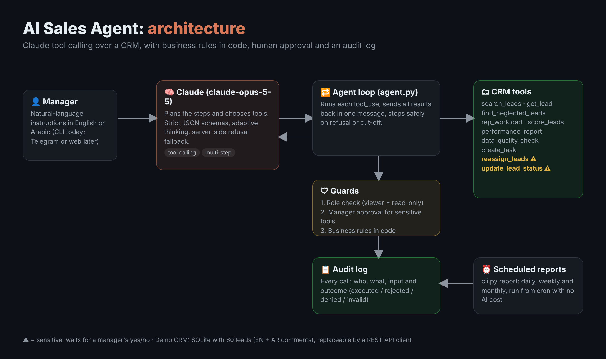
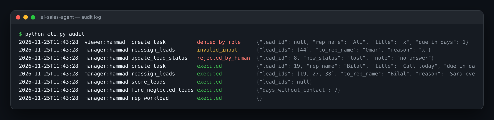
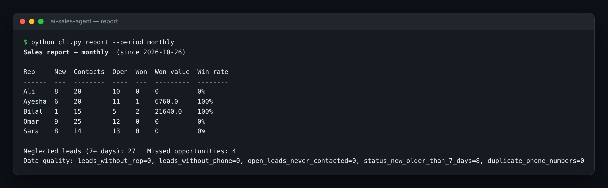
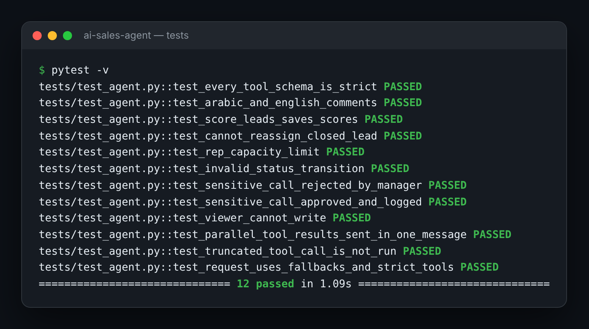

# AI Sales Management Agent

An AI assistant for a call-center sales team. A manager gives instructions in plain English or Arabic, and the agent uses **Claude tool calling** to read and act on the CRM: it scores leads, finds neglected leads and missed opportunities, rebalances workload between reps, creates follow-up tasks and produces performance reports.

It is built the way a production system should be: **business rules live in code, sensitive actions need a manager's approval, and every action is written to an audit log.**



## What it can do

| Ask the agent… | What happens |
|---|---|
| "Which leads have nobody called for 7 days? Group them by rep." | `find_neglected_leads` → table of neglected leads and missed opportunities |
| "Score all leads and show me the 10 hottest." | `score_leads` applies the fixed scoring rules (status, EN/AR comments, recency, deal value) |
| "Sara is overloaded. Move her 3 coldest open leads to whoever has capacity." | `rep_workload` → `search_leads` → **`reassign_leads` (waits for approval)** → `create_task` |
| "Give me the weekly report." | `performance_report`: per-rep activity, wins, win rate, neglected leads, data quality |
| "ما هي العملاء المحتملين المهملين؟" | Same tools; the reply comes back in Arabic |

## Tools

| Tool | Access | Purpose |
|---|---|---|
| `search_leads` | read | Filter by status, rep, score, inactivity |
| `get_lead` | read | Lead with full activity history (EN/AR comments) and tasks |
| `find_neglected_leads` | read | Open leads with no contact for N days, plus hot leads going cold |
| `rep_workload` | read | Open, won and total leads per rep, with the capacity limit |
| `score_leads` | read | Rule-based scoring 0–100 with reasons, saved to the CRM |
| `performance_report` | read | Daily, weekly or monthly KPIs per rep |
| `data_quality_check` | read | Missing reps or phones, duplicates, stale statuses |
| `create_task` | write | Follow-up task for a rep (logged) |
| `reassign_leads` | **sensitive** | Lead rotation: needs a manager's yes/no |
| `update_lead_status` | **sensitive** | Pipeline status change: needs a manager's yes/no |

## Safety layers

1. **Role permissions:** a `viewer` can only use read tools; write calls are denied and logged.
2. **Business rules in code** (`tools.py`), which the model cannot bypass:
   - closed (won/lost) leads cannot be reassigned
   - a rep may hold at most 25 open leads
   - at most 20 leads per reassignment
   - only valid pipeline transitions are accepted (for example `new → won` is rejected)
3. **Human approval:** every sensitive call stops and asks the manager. A rejection goes back to Claude as an error result, and Claude is told not to retry it in another form.
4. **Audit log:** every tool call is recorded with who asked, the tool, its input and the outcome: `executed`, `rejected_by_human`, `denied_by_role`, `invalid_input` or `error`.



## Claude API details

- Model `claude-opus-5-5` with adaptive thinking and `effort: medium` (change it in `SalesAgent(effort=...)`)
- **Strict tool schemas** (`strict: true`, `additionalProperties: false`), plus a runtime check in the loop
- Manual agent loop (`sales_agent/agent.py`):
  - parallel tool calls are sent back together in one message
  - full assistant content, including thinking blocks, is kept in the history
  - stops safely on `refusal`, and never runs a tool call that was cut off by `max_tokens`
  - handles `pause_turn`
- Server-side refusal fallback (`fallbacks: "default"`)
- Prompt caching on the request (`cache_control`)

## Scheduled reports (no AI cost)

Reports are plain code, so they can run on a schedule without calling the model:

```bash
python cli.py report --period weekly
```



Example cron entry (every Monday at 08:00):

```
0 8 * * 1  cd /opt/ai-sales-agent && python cli.py report --period weekly >> reports.log
```

## Setup

```bash
git clone https://github.com/Hammadullah506/ai-sales-agent.git
cd ai-sales-agent
pip install -r requirements.txt
export ANTHROPIC_API_KEY=your-key-here

python cli.py init          # create the demo CRM (60 leads, EN + AR comments)
python cli.py chat          # talk to the agent as a manager
python cli.py chat --role viewer
python cli.py audit         # see what the agent did
```

## Tests

The tests run fully offline: the CRM is in memory and Claude is replaced by a scripted fake client. They cover the business rules, approval and rejection, role denial, parallel tool results, cut-off tool calls and the request settings.

```bash
pip install -r requirements-dev.txt
pytest -v
```



## Connecting a real CRM

The demo CRM is SQLite (`sales_agent/crm.py`). For a real system, keep the tool names and schemas and replace each handler in `tools.py` with a call to the CRM's REST API. The approval, permission and audit layers do not change. Natural next steps:
- a Telegram or web interface for managers
- a VoIP integration through its API, or browser automation where no API exists
- n8n or webhooks to trigger the agent on CRM events

## Project structure

```
sales_agent/
  agent.py     Claude tool-calling loop, approvals, permissions, audit
  tools.py     tool schemas, handlers and business rules
  scoring.py   rule-based lead scoring (English + Arabic keywords)
  crm.py       demo CRM (SQLite) and audit log
cli.py         chat / ask / report / audit commands
tests/         offline tests with a fake Claude client
```

---

**Author:** Hammad Ullah, Python & Node.js automation developer. Available for AI agents, CRM automation and bot development.
